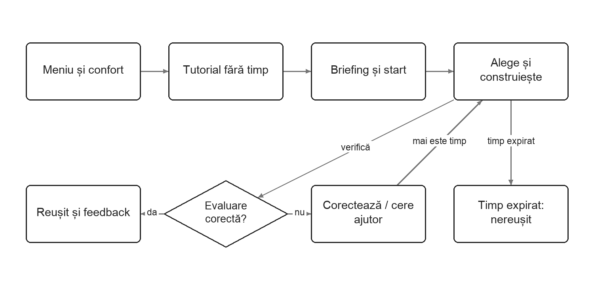
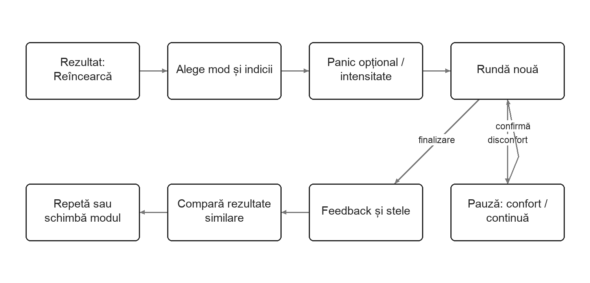
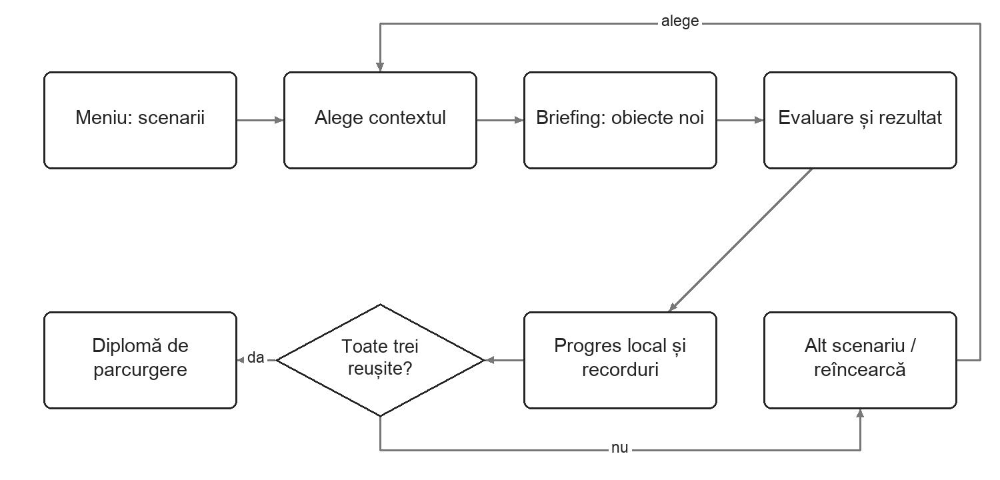
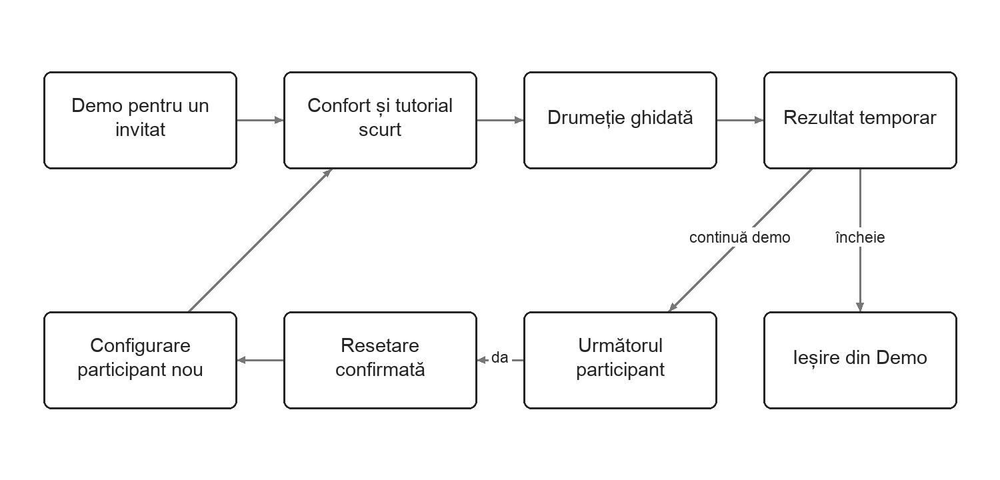
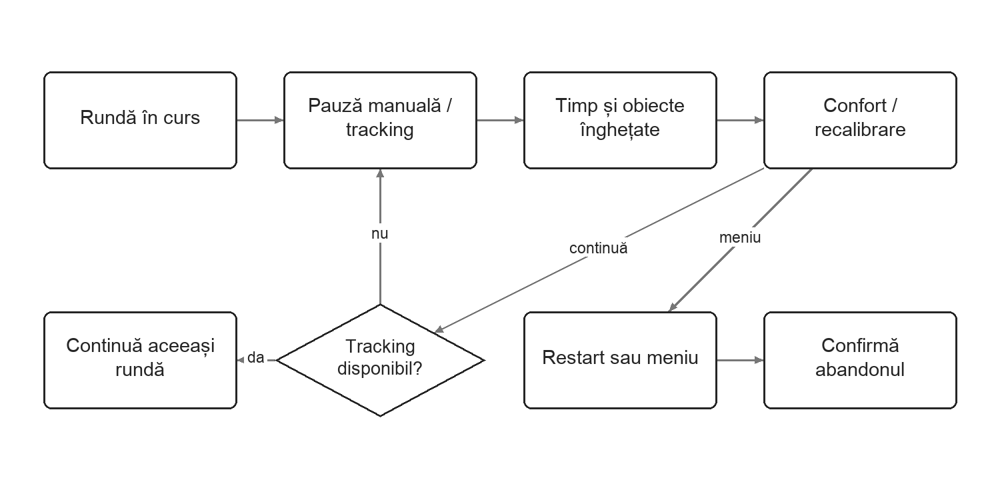
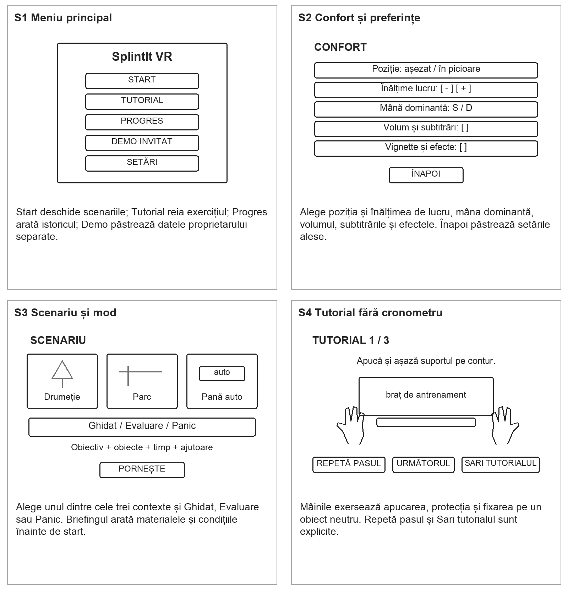
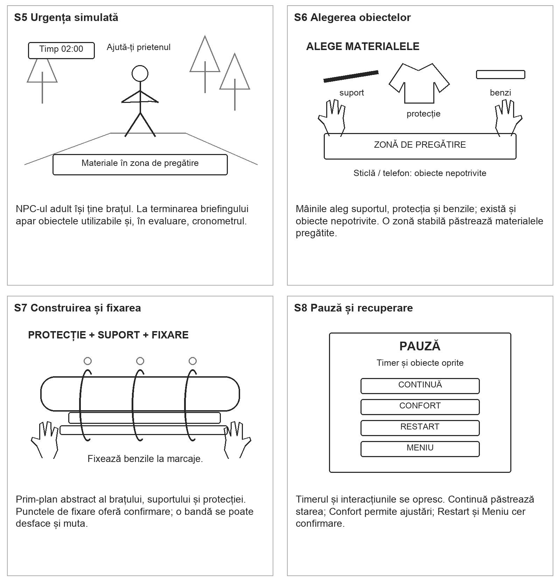
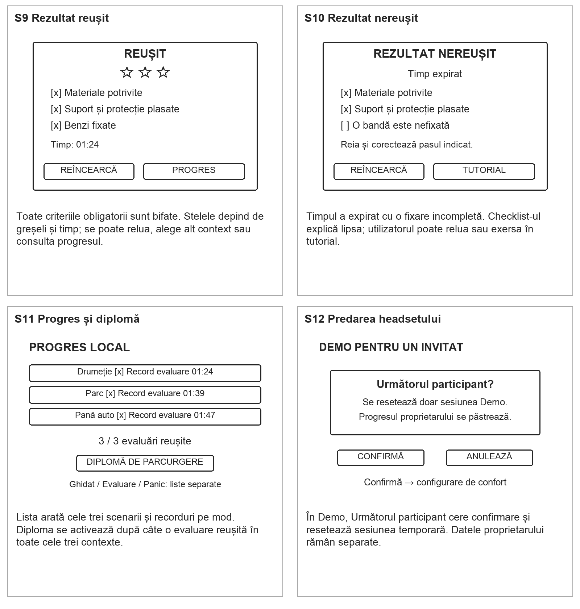

# SplintIt VR

O aplicație VR în care exersezi construirea unei atele improvizate din obiecte obișnuite, într-o situație de urgență simulată și sub presiunea timpului.

**Tema 5 Main Modules**

Echipă: Axinte Dragos, Calin Razvan-Andrei, Cabalau Rares, Spaiuc Robert

Aplicația este destinată sesiunilor individuale pe Meta Quest 2/3 și folosește interacțiuni cu mâinile sau controllerele. Documentul descrie versiunea ideală: trei contexte de joc, învățare ghidată, antrenament sub presiune și urmărirea progresului local. Toate funcționalitățile sunt propuneri de proiectare.

# User Story Map

## Utilizatorul 1 Andrei

Andrei are 21 de ani, este student, merge în drumeții și practică sport. Este familiarizat cu jocurile, dar are puțină experiență în VR și nu a urmat un curs de prim ajutor. Folosește propriul headset acasă, în sesiuni scurte. Își dorește să înțeleagă succesiunea unei sarcini și să poată repeta fără teama de a răni pe cineva.

### G1 Să înceapă o sesiune confortabil și să învețe interacțiunile

**A1 Pregătirea sesiunii**

• F1 Pornește fără cont; alege Continuă, Sesiune nouă sau Demo pentru un invitat.

• F2 Reglează poziția de joc așezat/în picioare, înălțimea zonei de lucru, mâna dominantă, volumul și subtitrările.

• F3 Alege snap turn, vignette și intensitatea efectelor; poate reveni la setările confortabile implicite.

**A2 Învățarea comenzilor**

• F1 Parcurge un tutorial fără cronometru: selectează UI, apucă, rotește, ține cu două mâini și eliberează un obiect.

• F2 Exersează poziționarea unui suport și fixarea unei benzi pe un braț de antrenament; vede un contur și confirmarea fiecărui pas.

• F3 Repetă un pas sau tot tutorialul; îl poate sări explicit și îl poate redeschide ulterior din meniu.

### G2 Să finalizeze o atelă improvizată și să înțeleagă rezultatul

**A1 Înțelegerea situației**

• F1 Alege contextul, citește obiectivul și modul de joc, apoi pornește când este pregătit.

• F2 Observă un NPC adult cu o leziune stilizată la braț, fără sânge; primește un mesaj scurt și un indicator al zonei de lucru.

• F3 În modul de evaluare, cronometrul începe după încheierea prezentării; în modul ghidat poate exersa fără limită.

**A2 Alegerea materialelor**

• F1 Examinează obiectele și selectează suportul rigid, materialul de protecție și benzile de fixare.

• F2 Pune materialele într-o zonă de pregătire; obiectele scăpate în afara spațiului accesibil pot fi readuse în această zonă.

• F3 Poate încerca și obiecte nepotrivite; jocul oferă explicații în modul ghidat și înregistrează greșelile pentru feedback.

**A3 Construirea și fixarea**

• F1 Poziționează suportul și protecția în zonele virtuale indicate; jocul verifică geometria, orientarea și ordinea etapelor.

• F2 Fixează benzile prin gesturi simplificate în punctele marcate; benzile pot fi desfăcute și repoziționate înainte de evaluare.

• F3 Primește feedback vizual, sonor și, cu controllere, haptic; un pas incomplet nu este marcat drept finalizat.

**A4 Evaluarea și corectarea**

• F1 Solicită verificarea; dacă lipsesc pași și mai există timp, vede ce trebuie corectat și poate continua.

• F2 Primește Reușit numai când toate criteriile obligatorii sunt îndeplinite; expirarea timpului produce Rezultat nereușit cu explicații.

• F3 Consultă checklist-ul și timpul; alege Reîncearcă, Tutorial, Alt scenariu sau Meniu. Numărul de greșeli influențează stelele, nu poate compensa o sarcină incompletă.

### G3 Să repete în condiții de presiune controlată

**A1 Alegerea dificultății**

• F1 Selectează Ghidat, Evaluare sau Panic mode înaintea rundei; vede dacă există limită de timp și ajutoare.

• F2 Dezactivează treptat indicatoarele și indiciile; ajutoarele nu dispar automat doar pentru că a reluat jocul.

• F3 Activează explicit Panic mode, cu sunete și efecte vizuale reglabile; poate opri efectele din pauză, iar runda este marcată ca asistată.

**A2 Reluarea și compararea**

• F1 Reia același scenariu cu obiectele și cronometrul resetate; poate schimba modul înainte de start.

• F2 Compară timpul, greșelile și stelele numai între runde din același scenariu și același mod.

• F3 O rundă ghidată, întreruptă prin restart sau finalizată cu ajutoare suplimentare nu înlocuiește recordul unei evaluări independente.

### G4 Să își urmărească progresul în situații diferite

**A1 Parcurgerea scenariilor**

• F1 Alege Drumeție, Parc de joacă sau Pană auto; toate sunt accesibile, cu o recomandare de ordine.

• F2 Repetă aceeași mecanică asupra unui NPC adult, cu alte obiecte: creangă/geacă, șipcă/hanorac, suport rigid/textil din portbagaj.

• F3 Consultă briefingul pentru noul set de materiale; păstrează controalele și regulile de feedback învățate.

**A2 Consultarea progresului**

• F1 Vede scenariile parcurse, rezultatele recente, cele mai bune evaluări și câte 1–3 stele pentru rundele reușite.

• F2 Primește o diplomă simbolică de parcurgere după o evaluare reușită în fiecare dintre cele trei scenarii; aceasta nu este o certificare profesională.

• F3 Salvează progresul doar local; poate afișa diploma unui prieten în headset sau poate șterge progresul propriu din Setări, cu confirmare.

## Utilizatorul 2 Participant la o demonstrație

Este un coleg, un prieten sau un participant la laborator care folosește temporar un headset comun. Nu are nevoie de cont, de progres persistent sau de instrumente de administrare pentru instructor. Are puțin timp și poate utiliza VR pentru prima dată.

### G5 Să încerce rapid aplicația

**A1 Intrarea în Demo**

• F1 Alege Demo pentru un invitat, cu progres separat de cel al proprietarului.

• F2 Primește configurarea de confort și tutorialul scurt; poate sări tutorialul printr-o alegere explicită.

• F3 Pornește direct scenariul Drumeție în mod ghidat; poate deschide ajutorul sau reveni în meniu oricând.

**A2 Predarea headsetului**

• F1 Vede rezultatul sesiunii curente fără a-l introduce în clasamentul proprietarului.

• F2 Alege Următorul participant și confirmă resetarea: rezultat, obiecte, cronometru, pași și preferințe temporare.

• F3 Următorul participant începe din configurarea de confort; Ieșire din Demo readuce meniul și profilul local al proprietarului.

## Reguli comune tuturor modulelor

**Pauză și ieșire**

Pauza oprește cronometrul și interacțiunile. Continuă păstrează starea; Restart și Meniu cer confirmare dacă există o rundă în curs. O rundă abandonată nu este înregistrată ca reușită.

**Pierderea trackingului**

Pierderea trackingului sau scoaterea headsetului declanșează pauza. Jocul reia numai după restabilirea trackingului și confirmarea utilizatorului. Obiectele devin din nou stabile înainte de continuare.

**Ajutor și recuperare**

Un obiect inaccesibil poate fi readus în zona de pregătire. Tutorialul poate fi reluat fără ștergerea progresului. Dacă o salvare nu poate fi citită, aplicația informează utilizatorul și permite o sesiune temporară fără suprascrierea datelor existente.

**Rezultate și confidențialitate**

Nu sunt necesare conturi, servicii online sau leaderboard global. Recordurile sunt locale și separate pe scenariu/mod; ștergerea progresului personal și resetarea unui invitat sunt acțiuni distincte.

**Criterii de joc**

Checklist-ul urmărește obiectele alese, zonele virtuale de plasare, pașii de protecție/fixare și timpul. Stelele exprimă performanța în simulare. Conținutul educațional și textele explicative vor fi revizuite înaintea implementării finale.

Acoperire: G1 → J1 și J5; G2 → J1; G3 → J2; G4 → J3; G5 → J4. Pauza și recuperarea din J5 se aplică tuturor rundelor.

# Journey Map

## J1 Prima sesiune și învățarea sarcinii

Utilizator: Andrei. Obiective: G1 și G2. Cadre: S1–S7, S9–S10.

Pornește prima dată aplicația și dorește să înțeleagă o rundă completă.

- **Intrare:** Alege confortul și tutorialul. Curiozitate; comenzi puține și explicite.

- **Exersare:** Manipulează obiectul de antrenament. Nesiguranță; confirmare imediată a pașilor.

- **Scenariu:** Selectează materialele și construiește. Concentrare; ajutoare la cerere.

- **Rezultat:** Citește checklist-ul de reușită sau eșec. Claritate; știe ce are de corectat.

După rezultat: Reîncearcă reia briefingul; Tutorial deschide exercițiul; Meniu încheie sesiunea. În mod ghidat nu apare ramura de expirare a timpului.

## J2 Reluare și antrenament sub presiune

Utilizator: Andrei. Obiective: G3. Cadre: S3, S5–S10.

A terminat o rundă și vrea să repete cu mai puțin ajutor.

- **Pregătire:** Alege evaluare sau panic, ajutoare și intensitate. Anticipare; știe condițiile înainte de start.

- **Execuție:** Reface sarcina cu cronometru și obiecte resetate. Presiune; poate pune pauză.

- **Adaptare:** Reduce efectele sau activează ajutor. Control; runda este etichetată asistată.

- **Comparație:** Vede rezultatele pe același scenariu și mod. Motivație; comparație relevantă.

Reușita și eșecul duc la același ecran de feedback, cu acțiuni clare. Oprirea efectelor nu pierde progresul anterior și nu păstrează în mod fals statutul de evaluare independentă.

## J3 Scenarii suplimentare și progres

Utilizator: Andrei. Obiective: G4. Cadre: S3, S9, S11.

Vrea să transfere mecanica în alte contexte și să vadă ce a parcurs.

- **Alegere:** Consultă Drumeție, Parc și Pană auto. Curiozitate; aceleași controale în toate scenele.

- **Adaptare:** Identifică noile materiale din briefing. Provocare; nu reînvață interfața.

- **Urmărire:** Consultă istoricul și recordurile locale. Satisfacție; vede progresul pe fiecare scenariu.

- **Încheiere:** Deschide diploma după trei evaluări reușite. Recunoaștere simbolică; o poate arăta în headset.

Un eșec nu șterge evaluările reușite anterior. Diploma rămâne indisponibilă până la îndeplinirea criteriului; progresul din Demo nu contribuie la ea.

## J4 Demonstrație pe un headset comun

Utilizator: Participant la demonstrație. Obiective: G5. Cadre: S1–S2, S4–S10, S12.

Un participant nou primește un headset folosit de altcineva.

- **Preluare:** Intră în modul invitat fără cont. Nesiguranță; configurare scurtă.

- **Încercare:** Parcurge tutorialul sau îl sare explicit. Încredere; ritm propriu, fără cronometru.

- **Final:** Vede rezultatul propriei încercări. Satisfacție; datele nu ajung la proprietar.

- **Predare:** Confirmă resetarea pentru următoarea persoană. Claritate; aceeași stare inițială pentru toți.

Resetarea din Demo șterge numai sesiunea invitatului. Ieșire din Demo restaurează meniul proprietarului. Participantul poate abandona din pauză, cu confirmare.

## J5 Confort pauză și recuperarea sesiunii

Utilizator: Oricare dintre utilizatori. Obiective: G1 și reguli comune. Cadre: S2, S8, S12.

Apare disconfort, se pierde trackingul sau utilizatorul dorește să întrerupă.

- **Întrerupere:** Pune pauză sau pierde trackingul. Disconfort; aplicația oprește presiunea timpului.

- **Ajustare:** Reglează confortul și recuperează obiectele. Control; instrucțiuni scurte.

- **Revenire:** Confirmă continuarea după restabilirea trackingului. Siguranță în interacțiune; nimic nu repornește brusc.

- **Abandon:** Confirmă restartul sau revenirea la meniu. Predictibilitate; progresul anterior este păstrat.

Anularea confirmării readuce meniul de pauză. Restart începe o rundă nouă; Meniu abandonează numai runda curentă. La redeschiderea aplicației se încarcă progresul finalizat, nu o rundă suspendată.

# Wireframing și Storyboarding

Schițele urmăresc poziția utilizatorului, obiectele și deciziile. Contururile, spațierile și elementele UI sunt intenționat abstracte; culorile și designul final vor fi stabilite ulterior.

**Cadrele S1, S2, S3, S4**

## Storyboarding continuare

**Cadrele S5, S6, S7, S8**

## Storyboarding continuare

**Cadrele S9, S10, S11, S12**

# Planning Asset Creation

Legendă: <u>creație proprie</u> = realizat de echipă; <mark>generat</mark> = generare planificată; resursele externe au link. Căsuțele sunt intenționat nebifate: reprezintă planul de producție. În Word sunt aplicate sublinierea și highlight-ul galben cerute.

## 3D

- [ ] **3D01** <u>Teren traseu și zonă de pregătire</u> — 1 scenă. Graybox din primitive, apoi potecă și buștean low-poly; scară 1 unitate = 1 m. Sursă/metodă: Blender și ProBuilder.

- [ ] **3D02** Vegetație și pietre de fundal — 6–10 modele reutilizate. Copaci, tufe, iarbă și roci; selecție din Nature Kit, materiale simple. Sursă/metodă: [R1 Kenney Nature Kit](https://kenney.nl/assets/nature-kit).

- [ ] **3D03** <u>NPC adult și braț separat</u> — 1 personaj și 1 braț modular. Model stilizat cu rig propriu; antebraț accesibil, fără detalii grafice de rănire. Sursă/metodă: Blender.

- [ ] **3D04** <u>Animații NPC</u> — 5 clipuri. Idle, dezechilibrare, ținut brațul, reacție la interacțiune și mulțumire; același rig în toate scenele. Sursă/metodă: Blender.

- [ ] **3D05** <u>Mâini virtuale</u> — 1 pereche. Mesh simplu, stări deschis/închis/apucare; adaptat controllerelor și trackingului. Sursă/metodă: Blender.

- [ ] **3D06** <u>Braț de antrenament</u> — 1 model. Suport neutru pe masă, cu aceleași zone de interacțiune ca NPC-ul. Sursă/metodă: Blender.

- [ ] **3D07** <u>Creangă și șipcă rigidă</u> — 3 variante. Suporturi cu siluete diferite; puncte de prindere și collidere simplificate. Sursă/metodă: Blender.

- [ ] **3D08** <u>Geacă și hanorac</u> — 2 modele. Stări liber și împăturit; protecție cu mesh predefinit, fără simulare completă de material. Sursă/metodă: Blender.

- [ ] **3D09** <u>Eșarfă și material pentru susținere</u> — 2 modele cu stări. Material liber, așezat și susținere finală; forme pregătite pentru gesturile simplificate. Sursă/metodă: Blender.

- [ ] **3D10** <u>Curea și benzi de fixare</u> — 3 variante de bandă. Stări liber, parțial înfășurat și fixat; fiecare cu puncte de prindere. Sursă/metodă: Blender.

- [ ] **3D11** <u>Obiecte nepotrivite</u> — 4 modele. Sticlă, piatră mică, telefon și rucsac; ușor de recunoscut și manipulat. Sursă/metodă: Blender.

- [ ] **3D12** <u>Recuzită tabără</u> — 4 modele. Cort, bancă, indicator de traseu și vatră decorativă; fără rol în rezolvarea sarcinii. Sursă/metodă: Blender.

- [ ] **3D13** <u>Parc de joacă</u> — 1 scenă și 4 props. Teren, bancă, leagăn, tobogan, balansoar; accidentatul rămâne un adult. Sursă/metodă: Blender.

- [ ] **3D14** Autovehicul pentru pana auto — 1 vehicul. Model selectat din Car Kit; portbagajul de interacțiune va fi adaptat de echipă. Sursă/metodă: [R2 Kenney Car Kit](https://kenney-assets.itch.io/car-kit).

- [ ] **3D15** <u>Drum și recuzită portbagaj</u> — 1 scenă și 3 props. Drum, bordură, portbagaj accesibil și suport rigid; reutilizează textilele și benzile. Sursă/metodă: Blender.

- [ ] **3D16** <u>Collidere și puncte de interacțiune</u> — Set pentru fiecare obiect. Zone de apucare, plasare, fixare și resetare; prefabs pentru tutorial și cele trei scene. Sursă/metodă: Unity.

## Graphics & 2D

- [ ] **G01** <u>Panouri principale</u> — 6 panouri. Meniu, setări, scenarii, tutorial, pauză și confirmări; UI în spațiul VR. Sursă/metodă: uGUI.

- [ ] **G02** <u>Rezultate și progres</u> — 4 panouri. Reușit, nereușit, progres/recorduri și diplomă de parcurgere. Sursă/metodă: uGUI.

- [ ] **G03** <u>Timer la încheietură și checklist</u> — 2 componente. Stări normal, timp redus, pauză și timp expirat; text și simboluri, nu doar culoare. Sursă/metodă: uGUI.

- [ ] **G04** <u>Indicatoare și instrucțiuni</u> — 8 pictograme și 6 carduri. Apucare, rotire, mâini, plasare, fixare, ajutor, pauză și resetare; pași pentru tutorial. Sursă/metodă: Desen vectorial propriu.

- [ ] **G05** <u>Miniaturi scenarii</u> — 3 imagini. Capturi din scenele proprii, adaptate la cardurile de selecție. Sursă/metodă: Unity.

- [ ] **G06** <mark>Logo și icon de aplicație</mark> — 1 concept și 2 exporturi. Concept generat în Adobe Firefly; echipa simplifică și redesenează conturul pentru lizibilitate. Sursă/metodă: [R5 Adobe Firefly](https://firefly.adobe.com/).

- [ ] **G07** <u>Materiale low-poly și cer</u> — 1 paletă și 3 preseturi. Materiale pentru textile/lemn și cer procedural pentru cele trei contexte. Sursă/metodă: Unity și Blender.

- [ ] **G08** <u>Stele și diplomă</u> — 1 set și 1 machetă. Stele, bife, cruci și diplomă simbolică; fără mărci ale unor organizații medicale. Sursă/metodă: Desen vectorial propriu.

- [ ] **G09** <u>Subtitrări și texte educaționale</u> — 1 set de texte. Briefinguri, indicii, explicații pentru rezultate și mesaje de confort. Sursă/metodă: Redactare proprie.

## Sounds

- [ ] **A01** <u>Ambianță de pădure</u> — 1 loop de 30–60 s. Înregistrare proprie de vânt și păsări, curățată și montată în buclă. Sursă/metodă: Înregistrare de teren.

- [ ] **A02** <u>Ambianță parc și drum</u> — 2 loopuri de 30–60 s. Înregistrări proprii de exterior fără conversații inteligibile; mixate discret. Sursă/metodă: Înregistrare de teren.

- [ ] **A03** <u>Muzică de meniu și explorare</u> — 1 loop de 30 s. Temă simplă compusă de echipă, cu instrumente sintetizate și volum redus. Sursă/metodă: Compoziție proprie.

- [ ] **A04** <u>Presiune timp redus</u> — 1 loop de 10 s. Puls ritmic sintetizat; intensitate reglabilă, fără a masca indicațiile. Sursă/metodă: Sinteză audio proprie.

- [ ] **A05** <u>Apucare și eliberare</u> — 4 sunete scurte. Contact lemn/plastic și așezarea pe suprafața de pregătire. Sursă/metodă: Foley înregistrat de echipă.

- [ ] **A06** <u>Textile și fixare</u> — 4 sunete scurte. Foșnet de geacă/eșarfă, tensionare bandă și închiderea fixării. Sursă/metodă: Foley înregistrat de echipă.

- [ ] **A07** Interfață și confirmări — 4 sunete. Click, selectare, confirmare și eroare, selectate din Interface Sounds. Sursă/metodă: [R3 Kenney Interface Sounds](https://kenney.nl/assets/interface-sounds).

- [ ] **A08** <u>Reușită și eșec</u> — 2 semnale de 1–2 s. Mici secvențe sintetizate, distincte și neagresive. Sursă/metodă: Compoziție proprie.

- [ ] **A09** <mark>Voce NPC și tutorial</mark> — 12 replici. Replici scurte: briefing, solicitare, indiciu, confirmare și mulțumire; voce sintetică de bibliotecă, fără clonare. Sursă/metodă: [R6 ElevenLabs Text to Speech](https://elevenlabs.io/text-to-speech).

- [ ] **A10** <u>Panic mode</u> — 1 loop și 2 preseturi. Bătăi sintetizate și filtrare a ambianței; control de intensitate și oprire din pauză. Sursă/metodă: Sinteză proprie și Unity Audio Mixer.

## VFX

- [ ] **V01** <u>Contur pentru obiecte utilizabile</u> — 1 shader cu 3 stări. Disponibil, selectat și plasat; combinat cu simboluri și text. Sursă/metodă: Shader Graph.

- [ ] **V02** <u>Marcaje de plasare și fixare</u> — 3 forme reutilizabile. Contur de suport, zonă de protecție și punct de bandă; dispar când pasul este valid. Sursă/metodă: Shader Graph și mesh propriu.

- [ ] **V03** <u>Feedback de reușită</u> — 1 efect. Scurtă apariție de stele pe ecranul de rezultat; fără efecte puternice în câmpul vizual. Sursă/metodă: Unity Particle System.

- [ ] **V04** <u>Foc de tabără decorativ</u> — 1 efect. Flacără stilizată și particule puține; element ambiental care nu cere interacțiune. Sursă/metodă: Unity Particle System.

- [ ] **V05** <u>Panic și tranziții</u> — 3 preseturi. Vignette, blur discret și reducere cromatică opționale; fade la schimbarea scenei. Sursă/metodă: URP post-processing.

## Alte asseturi

- [ ] **O01** XR rig și acțiuni de input — 1 configurație adaptată. Prefabs și input actions de bază din XRI Starter Assets; legături pentru UI și obiecte. Sursă/metodă: [R4 Unity XRI Starter Assets](https://docs.unity3d.com/Packages/com.unity.xr.interaction.toolkit@3.0/manual/samples-starter-assets.html).

- [ ] **O02** <u>Datele scenariilor</u> — 3 fișiere de configurare. Materiale acceptate, puncte de plasare, timpi, pași, texte și condiții de rezultat. Sursă/metodă: Unity ScriptableObjects.

- [ ] **O03** <u>Profil local și clasamente</u> — 1 schemă de salvare. Setări, rezultate și recorduri separate pe scenariu/mod; sesiune Demo în memorie. Sursă/metodă: JSON local.

- [ ] **O04** <u>Conținut tutorial și rubrici</u> — 1 tutorial și 3 checklist-uri. Scenarii educaționale, mesaje și criterii de joc revizuite înainte de utilizare. Sursă/metodă: Redactare și verificare de conținut.

- [ ] **O05** <u>Preseturi haptice</u> — 3 tipare. Confirmare apucare, fixare și rezultat, pentru controllere compatibile. Sursă/metodă: Unity XRI.

- [ ] **O06** <u>Inventar surse și credite</u> — 1 registru. URL, autor, licență și fișiere selectate pentru fiecare resursă externă; separat de progresul jocului. Sursă/metodă: Markdown în repo.

## Surse pentru resurse și generare

Sursele au fost consultate la 2 noiembrie 2026. Selecția exactă a fișierelor și adaptarea lor vor fi consemnate la import; lista de mai sus fixează pachetul sau metoda planificată.

- **R1 [Kenney Nature Kit](https://kenney.nl/assets/nature-kit)** — Pachet pentru vegetație și roci; pagina autorului indică CC0.

- **R2 [Kenney Car Kit](https://kenney-assets.itch.io/car-kit)** — Pachet de vehicule; pagina autorului indică CC0.

- **R3 [Kenney Interface Sounds](https://kenney.nl/assets/interface-sounds)** — Pachet pentru interfață; pagina autorului indică CC0.

- **R4 [Unity XRI Starter Assets](https://docs.unity3d.com/Packages/com.unity.xr.interaction.toolkit@3.0/manual/samples-starter-assets.html)** — Prefabs și input actions; se păstrează notificările și licența incluse în pachetul utilizat.

- **R5 [Adobe Firefly](https://firefly.adobe.com/)** — Instrument planificat pentru conceptul de logo; rezultatul va fi prelucrat de echipă.

- **R6 [ElevenLabs Text to Speech](https://elevenlabs.io/text-to-speech)** — Instrument planificat pentru replici sintetice; utilizarea exporturilor va respecta planul și condițiile serviciului.

## Prioritizarea implementării

Prima versiune implementabilă va avea scena Drumeție, tutorialul, selectarea obiectelor, construirea/fixarea, cronometrul, feedbackul și setările de confort. Versiunea ideală descrisă în această temă adaugă cele două contexte, Panic mode, progresul local, diploma și Demo. Aceste extensii sunt documentate integral chiar dacă implementarea lor va fi prioritizată ulterior.

## 5. Graybox plan (prototype scene)

All objects gray, primitive, real-world scale (1 Unity unit = 1 m), to test scale and feel in VR.

| Element | Primitive | Approx. size |
|---|---|---|
| Ground | Plane / flat cube | 20 x 20 m |
| Trail | Flattened cube | 2 m wide |
| Log (ready spot) | Cylinder on its side | 2 m long, 0.4 m wide |
| Friend NPC | Capsule + separate cylinders for arms | ~1.75 m tall, forearm 0.25 m, upper arm 0.30 m |
| Stick | Thin cylinder | 0.8 m long, 3 cm wide |
| Jacket | Flat cube | 0.6 x 0.7 m, 3 cm thick |
| Strap / belt | Thin long cube | 1 m x 3 cm x 0.5 cm |
| Scarf | Flat long cube | 1.5 m x 15 cm |
| Distractors (bottle, rock, backpack) | Cylinder, sphere, cube | bottle 22 cm tall, backpack 30x45x20 cm |
| Trees (background) | Cylinders | 5 m tall |

**What to test in VR:** can the player reach the objects, does the friend's arm feel the right size, is the stick comfortable to hold, and are 2-3 tie points easy to reach.
