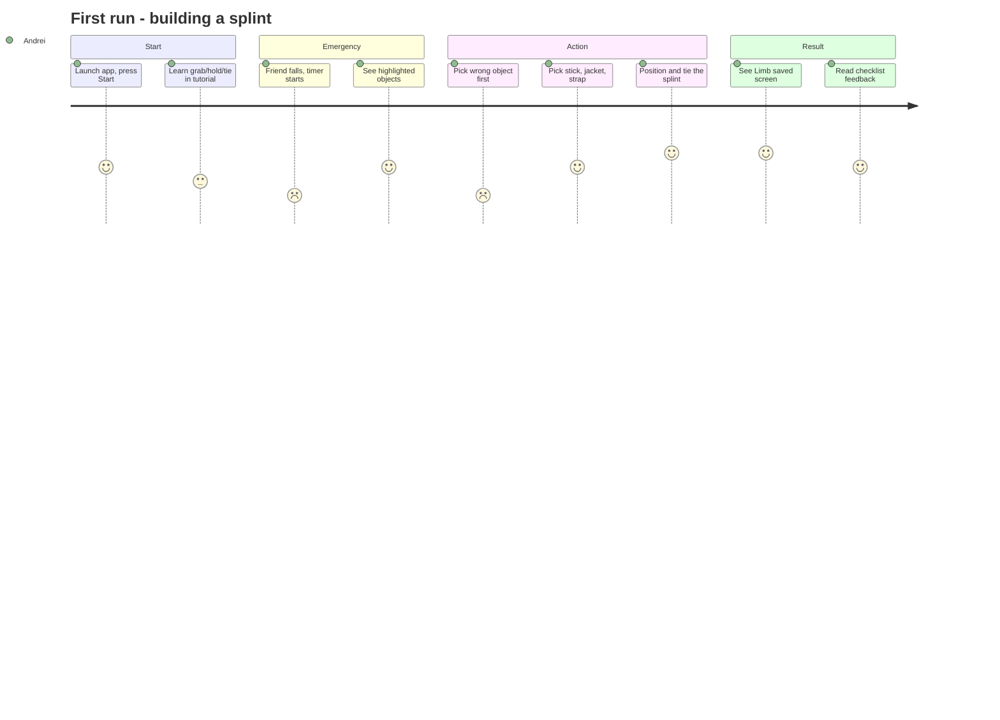
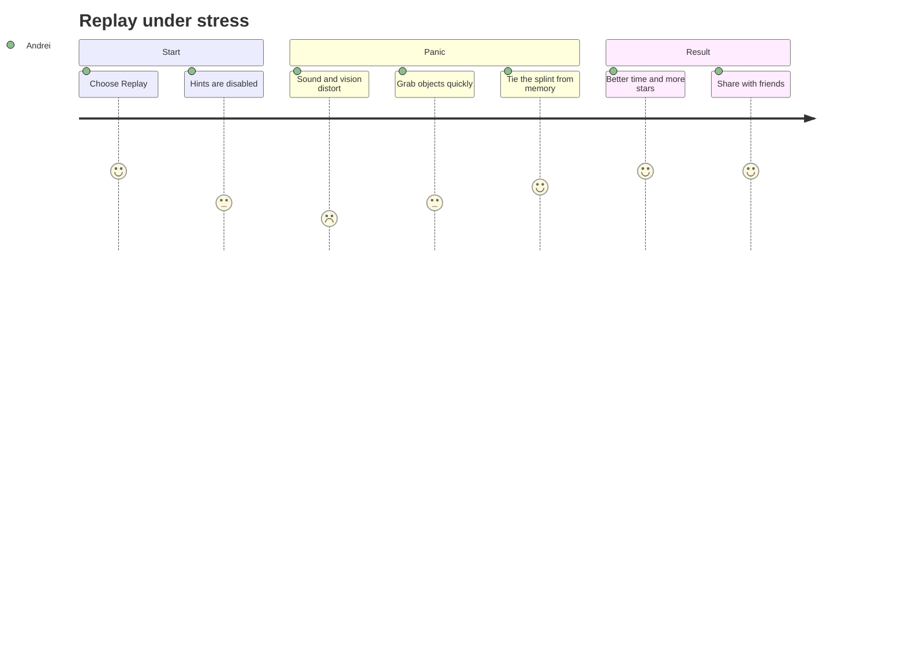
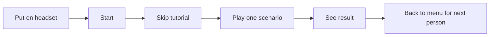
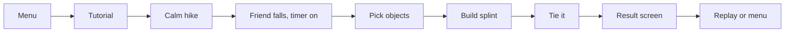

# SplintIt VR: Detailed Definition (Homework 2)

**A VR first-aid trainer where you improvise a splint from everyday objects under time pressure, so your hands already know what to do in a real emergency.**

*(Ideal version of the app. How much gets implemented by the end of the semester is decided later.)*

**Main feature (focus of this document):** building and tying an improvised splint on a friend's broken arm, step by step, with hand interaction and a timer.

---

## 1. User Story Map (2p)

### User 1: Andrei, 21, university student (primary user)
Andrei is active and sporty (hiking, football, cycling), is comfortable with games, has tried VR a few times and has never had first-aid training. He plays at home on his own headset, in short sessions.

**Goal 1. He wants to learn how to immobilize a broken arm with whatever is around, so he can act in a real emergency.**

1. **Activity 1: Get ready and understand the controls.** For this, in our app he will be able to:
   1. Start the app from the main menu with a single "Start" button.
   2. Do a 1-minute tutorial that teaches grabbing, holding with both hands and tying (on a harmless training object, no injury).
   3. Choose seated or standing play and turn on comfort options (vignette, snap turn).
2. **Activity 2: Assess the scene.** Then he will be able to:
   1. See a calm hiking scene change when his friend (NPC) falls and holds his arm.
   2. Look at the friend's arm to see which part is injured (a stylized, non-graphic highlight on the forearm).
   3. See the countdown timer start and the objects that can be used become highlighted.
3. **Activity 3: Pick and prepare the materials.** Then he will be able to:
   1. Pick up 3-4 highlighted objects (stick, jacket, strap, scarf) and look at them from all sides.
   2. Throw away objects that don't fit (e.g. a water bottle, a rock). Wrong choices are tracked for the feedback.
   3. Put selected objects on a "ready" spot (e.g. a log) before using them.
4. **Activity 4: Build and tie the splint.** Then he will be able to:
   1. Hold a rigid object (stick) along the arm so it spans the joint above and below the injury.
   2. Place padding (jacket, scarf) between the rigid object and the arm.
   3. Tie the splint in 2-3 places (strap, scarf) by moving his hands around the arm until each tie snaps in place.
   4. Optionally make a sling from the remaining cloth.
5. **Activity 5: Get feedback.** Then he will be able to:
   1. See a "Limb saved" or "Failed" screen.
   2. See a short checklist: right objects? joints covered? ties secure? time?
   3. Choose to replay, go to the menu, or (later) move to another scenario.

**Goal 2. He wants to stay calm under stress and not freeze.**

1. **Activity 1: Train under pressure.** In our app he will be able to:
   1. Play against the timer with a visible but non-aggressive countdown.
   2. Get less help each run (hints and highlights off in later runs).
2. **Activity 2: Experience "panic mode" (stretch).** Then he will be able to:
   1. Activate a mode with distorted sound and vision and a nervous NPC.
   2. Replay the same scenario calmly and see the difference in his time and score.

**Goal 3. He wants to improve and show it to friends.**

1. **Activity 1: Track progress.** In our app he will be able to:
   1. Earn 1-3 stars per run (time, correctness, fewer mistakes).
   2. See his best times on a replay leaderboard (stretch).
2. **Activity 2: Try different situations (stretch).** Then he will be able to:
   1. Play other scenarios (playground, car breakdown) with different injuries and different objects.
   2. Earn a first-aid "certificate" screen after completing all scenarios.

### User 2: Instructor / friend using a shared headset (secondary)
This user is a friend of Andrei or someone at the university VR lab. They have little time, use the headset that isn't theirs, and may be very new to VR.

**Goal: Try the experience quickly without setup.**
1. **Activity 1: Jump in.**
   1. Start without an account or login.
   2. Skip the tutorial after the first time.
2. **Activity 2: Reset for the next person.**
   1. Return to the main menu from any screen with one button.
   2. Restart the current scenario without taking off the headset.

---

## 2. Journey Maps (2p)

### Journey 1: First run (Andrei)



### Journey 2: Replay with less help / panic mode (Andrei)



### Journey 3: Quick try on a shared headset (User 2)



---

## 3. Wireframing / Storyboarding (3p)

> Rough text sketches of the key moments. Replace or add hand-drawn sketches/Excalidraw images in `images/` if you have them. Design decisions are not important here, only the visual flow.

### Frame 1: Main menu (world-space panel in front of the player)
```
+--------------------------------+
|           SplintIt VR          |
|                                |
|          [  START  ]           |
|          [ SETTINGS ]          |
|          [  QUIT   ]           |
+--------------------------------+
```

### Frame 2: Emergency starts (hiking trail)
```
        trees      trees
   ____________________________
  |                            |
  |      (friend NPC)          |
  |       holds his arm        |
  |                            |
  |  [timer 02:00]  <- on the  |
  |                  left wrist|
  |   stick  jacket  strap     |
  |  (glowing outlines)        |
  |____________________________|
```

### Frame 3: Picking objects
```
  Player's hands -> grab glowing objects

    [stick]   [jacket]   [strap]    [bottle X]  [rock X]
       ^ correct             wrong objects, no glow
       
  Placing spot: a log on the ground ("ready" zone)
```

### Frame 4: Building the splint (close-up of the arm)
```
   shoulder ---- elbow ======== wrist - hand
                  |   [stick]   |
                  |  [padding]  |
                  X    X    X   <- tie points (ghost markers)
  Left hand holds the stick, right hand wraps the strap around X
```

### Frame 5: Result screen
```
+--------------------------------+
|        LIMB SAVED  ★★☆         |
|  [v] Rigid object used         |
|  [v] Joints above/below covered|
|  [x] Ties not tight enough     |
|  Time: 01:24                   |
|  [ REPLAY ]    [ MENU ]        |
+--------------------------------+
```

### Storyboard (flow)


---

## 4. Planning Asset Creation (3p)

**Legend** (in the Google Doc: underline = self-made, yellow highlight = generated, plain = link):
- **[SELF-MADE]** to underline
- **[GENERATED]** to highlight yellow
- **[LINK]** source

### 3D
(Unity Asset Store, Fab, Sketchfab, TurboSquid, CGTrader, Poly Pizza, Kenney)

- Graybox scene (ground, trail, log, bench): **[SELF-MADE]** (ProBuilder / Blender)
- Injured arm / friend NPC body (low-poly, stylized): **[SELF-MADE]** (Blender), rig with Mixamo https://www.mixamo.com/
- Player hands (low-poly stylized): **[LINK]** XR Interaction Toolkit samples / Unity XR Hands sample https://docs.unity3d.com/Packages/com.unity.xr.hands@latest
- Stick / branch (several variations): **[SELF-MADE]** (Blender)
- Jacket (draped cloth look, flat low-poly): **[SELF-MADE]** (Blender)
- Strap / belt: **[SELF-MADE]** (Blender)
- Scarf / cloth for ties and sling: **[SELF-MADE]** (Blender) or **[GENERATED]** (AI tool) if time is short
- Distractor objects (water bottle, rock, backpack, phone): **[LINK]** https://poly.pizza/ and https://kenney.nl/assets
- Trees, bushes, rocks, grass (low-poly nature): **[LINK]** https://kenney.nl/assets/nature-kit and https://assetstore.unity.com/
- Tent, campfire, bench, signposts: **[LINK]** https://sketchfab.com/ (CC-licensed low-poly)
- Playground props (swing, slide, seesaw): **[LINK]** https://poly.pizza/ *(stretch)*
- Car and road for breakdown scenario: **[LINK]** https://kenney.nl/assets/car-kit *(stretch)*

### Graphics & 2D

- UI panels (menu, result screen, hints): **[SELF-MADE]** (Unity UI Toolkit / uGUI)
- Wrist timer face: **[SELF-MADE]**
- Icons (stars, check, cross, hint, replay): **[LINK]** https://kenney.nl/assets/game-icons
- Skybox (sunset / day): **[LINK]** https://assetstore.unity.com/ or https://polyhaven.com/hdris
- App logo: **[GENERATED]** (AI tool), then edited
- Certificate image (stretch): **[SELF-MADE]** (Canva)
- Highlight outline shader / material for usable objects: **[SELF-MADE]** (Shader Graph)

### Sounds
(freesound.org, ElevenLabs, ...)

- Ambient forest (birds, wind): **[LINK]** https://freesound.org/
- Calm background music for menu and scene: **[LINK]** https://freesound.org/ or https://pixabay.com/music/
- Tense music when the timer is low: **[LINK]** https://pixabay.com/music/
- Friend NPC voice lines ("my arm!", "thank you"): **[GENERATED]** https://elevenlabs.io/
- Grab / release object, cloth rustle, tie knot sound: **[SELF-MADE]** (recorded with a phone) or **[LINK]** https://freesound.org/
- UI click / hover: **[LINK]** https://freesound.org/
- Success jingle and fail sound: **[LINK]** https://freesound.org/
- Panic mode effects (heartbeat, muffled sound): **[LINK]** https://freesound.org/ + Unity Audio Mixer low-pass filter *(stretch)*

### VFX

- Highlight glow on usable objects: **[SELF-MADE]** (Shader Graph)
- Ghost markers for tie points: **[SELF-MADE]**
- Success sparkles / stars burst: **[SELF-MADE]** (Unity Particle System)
- Campfire (background): **[LINK]** Unity Asset Store free particle packs https://assetstore.unity.com/
- Panic mode: vision blur, vignette, chromatic aberration: **[SELF-MADE]** (URP post-processing) *(stretch)*

### Other assets / tools

- XR Interaction Toolkit: https://docs.unity3d.com/Packages/com.unity.xr.interaction.toolkit@latest
- ProBuilder (graybox): https://docs.unity3d.com/Packages/com.unity.probuilder@latest
- Blender: https://www.blender.org/
- Git LFS (for large assets): https://git-lfs.com/

---

## 5. Graybox plan (prototype scene)

All objects gray, primitive, real-world scale (1 Unity unit = 1 m), to test scale and feel in VR.

| Element | Primitive | Approx. size |
|---|---|---|
| Ground | Plane / flat cube | 20 x 20 m |
| Trail | Flattened cube | 2 m wide |
| Log (ready spot) | Cylinder on its side | 2 m long, 0.4 m wide |
| Friend NPC | Capsule + separate cylinders for arms | ~1.75 m tall, forearm 0.25 m, upper arm 0.30 m |
| Stick | Thin cylinder | 0.8 m long, 3 cm wide |
| Jacket | Flat cube | 0.6 x 0.7 m, 3 cm thick |
| Strap / belt | Thin long cube | 1 m x 3 cm x 0.5 cm |
| Scarf | Flat long cube | 1.5 m x 15 cm |
| Distractors (bottle, rock, backpack) | Cylinder, sphere, cube | bottle 22 cm tall, backpack 30x45x20 cm |
| Trees (background) | Cylinders | 5 m tall |

**What to test in VR:** can the player reach the objects, does the friend's arm feel the right size, is the stick comfortable to hold, and are 2-3 tie points easy to reach.

---

## Checklist for this week
- [ ] Copy this to the Google Doc template and link it in the repo README
- [ ] Underline / highlight assets as in the legend
- [ ] Add hand-drawn or Excalidraw sketches of the key frames (optional)
- [ ] Graybox the hiking scene in ProBuilder/Blender and test scale in VR
