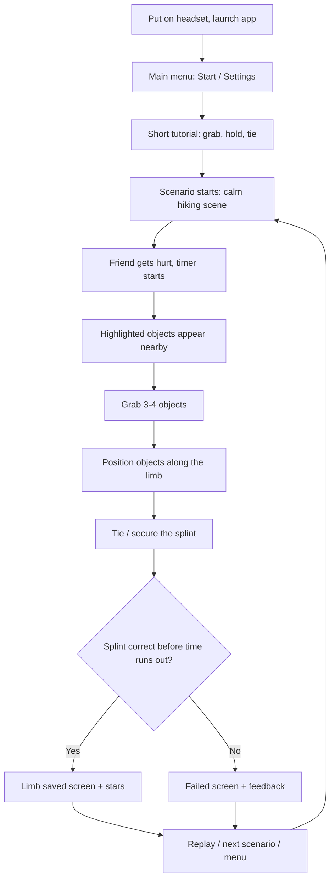
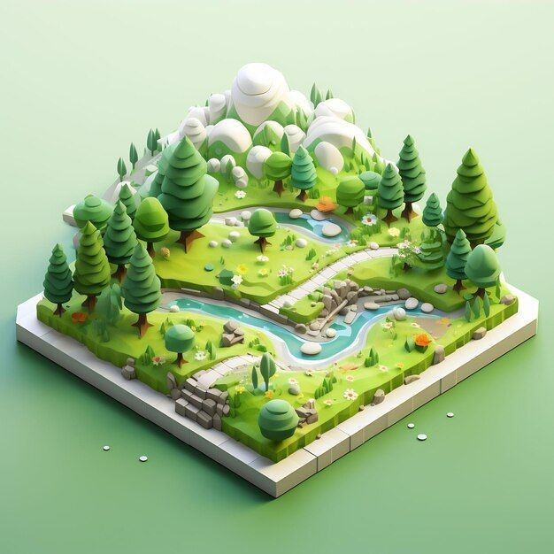
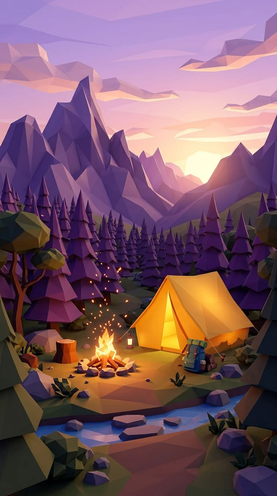
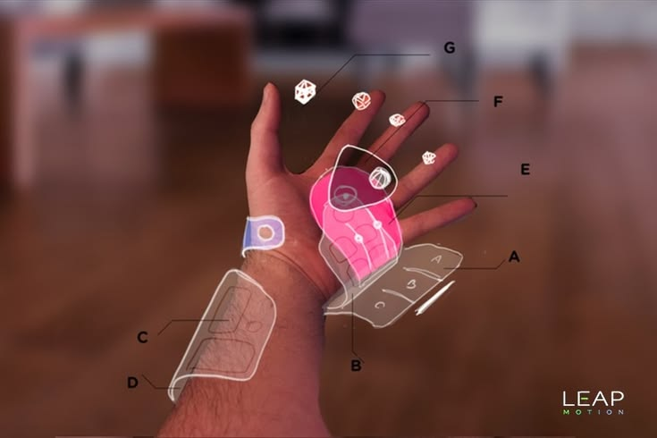
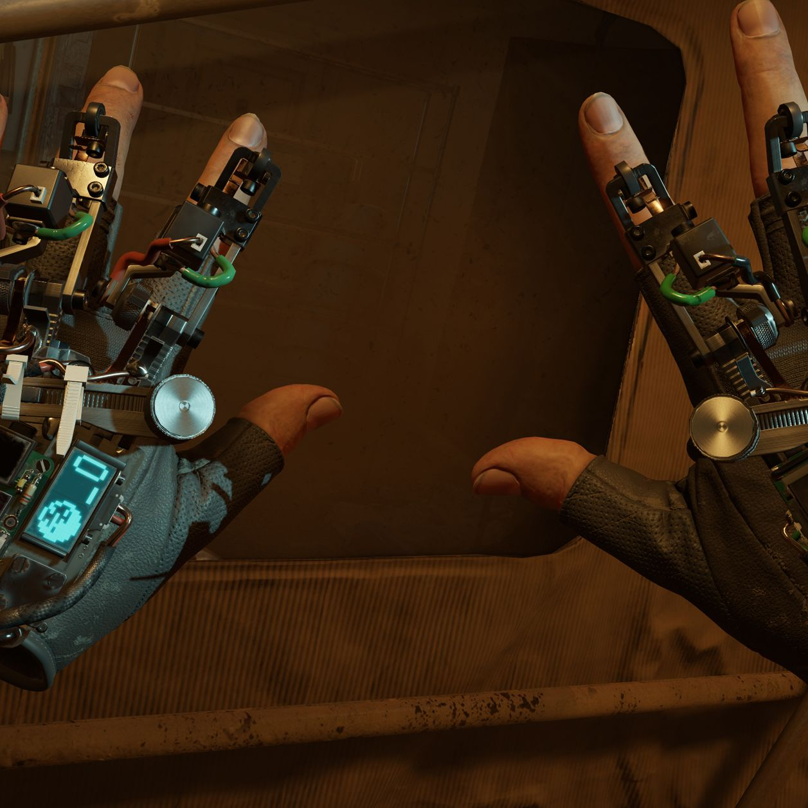
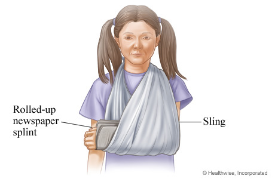
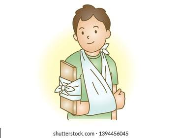
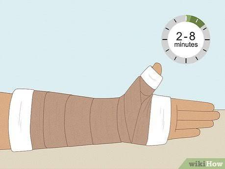
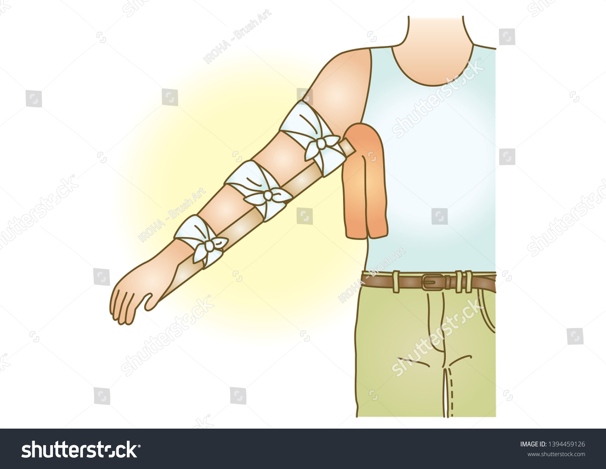

# SplintIt VR
**A VR first-aid trainer where you improvise a splint from everyday objects under time pressure, so your hands already know what to do in a real emergency.**

**Team members:** Axinte Dragos, Calin Razvan-Andrei, Cabalau Rares, Spaiuc Robert   
**Platform:** Standalone VR headset (Meta Quest 2/3), Unity + XR Interaction Toolkit
**Repo:** <link to public GitHub repo>

---

## Description

**1. Why this app**
Most people learn first aid from YouTube videos or articles. That gives them knowledge, but when something real happens (a friend breaks an arm on a hike) they freeze, because their hands have never done it. Our target user, Andrei (21, sporty, comfortable with games, no first-aid training), wants to feel prepared and responsible, but what he really needs is confidence and muscle memory: the certainty that he can act calmly under stress.

**2. How it achieves the why**
The player is placed in a realistic but stylized emergency scene (e.g. a friend with a broken arm on a hiking trail). Nearby objects are highlighted (stick, jacket, strap, scarf), and the player must grab them and physically build and tie a splint, step by step, against a countdown timer. Learning by doing, with real hand movements, builds muscle memory that videos can't. Each run ends with a pass/fail grade and feedback on what was done right or wrong. Repeating scenarios with different objects trains improvisation, not memorization of one fixed solution.

**3. What is different**
- Existing first-aid apps and videos are passive (read/watch); we are *hands-on*.
- Existing VR "simulators" (Job Simulator, Surgeon Simulator) are comedy-focused; ours is a real skill trainer that is still fun and low-poly friendly.
- Medical VR training tools are expensive and aimed at professionals; ours targets ordinary people, runs at home, and focuses on *improvising with everyday junk* rather than using a medical kit.
- Zero risk and no gore: stylized visuals, no realistic blood or distorted limbs (addresses the risk of scaring users).

---

## Similar products & relevant links

**Name:** Job Simulator
**Url:** https://jobsimulatorgame.com/
**Relevant features:**
- Playful, hands-on object interaction, "ordinary person does a task" feeling
- Soft, clean, low-poly visual style that feels approachable
- Grabbing and combining everyday objects with physics

**Name:** Surgeon Simulator (VR version)
**Url:** https://www.bossalien.com/
**Relevant features:**
- Clumsy-hands-under-pressure gameplay; inspiration for our "calm" opposite-experience mode
- Procedure done step by step on a patient
- Strong comedic/viral appeal (useful for trailer and sharing)

**Name:** Half-Life: Alyx
**Url:** https://store.steampowered.com/app/546560/HalfLife_Alyx/
**Relevant features:**
- Calm, precise handling of items while under tension (one-handed reload, healing)
- Best-in-class VR hand interaction and physical feedback cues
- Grabbing, holding and using objects with believable physics

**Name:** American Red Cross First Aid app
**Url:** https://www.redcross.org/get-help/how-to-prepare-for-emergencies/mobile-apps.html
**Relevant features:**
- Trusted first-aid content (steps for fractures, bleeding, CPR) we can base our correct procedures on
- Quizzes and step-by-step guides (what users use today)
- Shows the gap: knowledge without practice

**Name:** Moss
**Url:** https://www.polyarcgames.com/games/moss
**Relevant features:**
- Stylized, friendly look that avoids a harsh or scary tone
- Warm lighting and readable, uncluttered scenes

---

## Main features

**PRINCIPAL MAIN VERY IMPORTANT FEATURE:**

* **Improvised splint building with physical hand interaction.** The player grabs highlighted everyday objects (stick, jacket, strap, scarf, etc.) with their hands, positions them along the injured limb, and ties/secures them. The game checks the result (rigid support placed correctly, limb immobilized above and below the injury, secured with ties) and gives a pass/fail grade. This is the core loop and the thing that cannot be done in a video or a 2D app.

**Other features:**

* **Timer and urgency system:** countdown per scenario to create realistic, controlled stress.
* **Step-by-step guidance + hints:** highlighted objects, optional on-screen hints, with hints disabled in later runs.
* **Result screen and feedback:** "Limb saved" / "Failed" screen with what was done right or wrong (correct objects, correct placement, time).
* **Multiple scenarios (stretch):** hiking trail, playground, car breakdown, each with different injuries and different objects to improvise with.
* **"Panic mode" (stretch):** distorted sound and vision to simulate stress, then a calm mode to show improvement.
* **Stars, replay leaderboard and first-aid certificate (stretch).**
* **Comfort/safety settings:** stylized non-graphic injuries, vignette for comfort, seated or standing play.

### Scope

| Goal | What it includes (10 weeks) |
|---|---|
| **Minimum** | One hiking-trail scene. A friend NPC with a hurt arm. 3–4 highlighted objects. Build and tie a splint. Ending with a "Limb saved" screen. |
| **Maximum** | Three scenarios (hiking, playground, car breakdown), panic mode, star ratings, replay leaderboard, certificate. |

---

## User journey diagram

---

## Moodboard (10+ images)

### Visual style and environment

|  |  |
|---|---|
| **Isometric low-poly landscape.** Soft, clean, friendly shapes and a fresh green palette. | **Low-poly camp at sunset.** Warm glowing light against cool purple tones; mood for the hiking scenario. |

### Hand interaction in VR

|  |  |
|---|---|
| **Leap Motion hand UI.** Reference for hand-attached, diegetic UI (timer, hints). | **Half-Life: Alyx hands.** Reference for believable, precise hand presence in VR. |

### Gameplay reference: improvised splints

|  |  |
|---|---|
| **Rolled-up newspaper splint + sling.** An everyday object turned into a splint. | **Board splint + sling.** Clear final result the player has to reproduce. |

|  |  |
|---|---|
| **Bandage wrap with a timer (2-8 min).** Idea for showing time pressure and wrapping steps. | **Arm splint tied in three places.** Shows correct placement of the ties along the limb. |

## Technologies, libraries, assets

1. **Unity (6000.x)**: game engine. https://unity.com/
2. **Unity XR Interaction Toolkit**: grabbing, hands, interactions. https://docs.unity3d.com/Packages/com.unity.xr.interaction.toolkit@latest
3. **XR Hands / OpenXR plugin**: hand tracking and Quest support. https://docs.unity3d.com/Packages/com.unity.xr.hands@latest
4. **Meta XR All-in-One SDK (optional)**: Quest-specific features. https://developers.meta.com/horizon/downloads/package/meta-xr-sdk-all-in-one-upm/
5. **Blender**: custom low-poly assets and hand/limb models. https://www.blender.org/
6. **Kenney assets**: free low-poly props and nature. https://kenney.nl/assets
7. **Poly Pizza**: free low-poly models. https://poly.pizza/
8. **Mixamo**: free character rigs and animations for the injured NPC. https://www.mixamo.com/
9. **Freesound**: ambient and stress sound effects. https://freesound.org/
10. **GitHub + Git LFS**: version control for the project and large assets. https://github.com/

---

